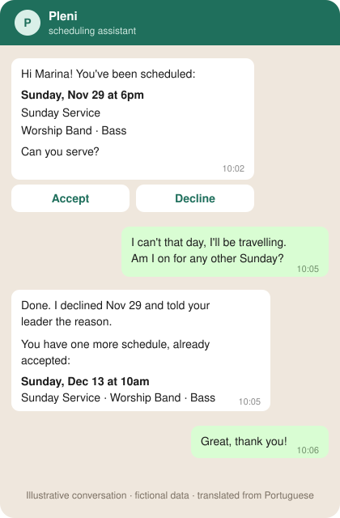
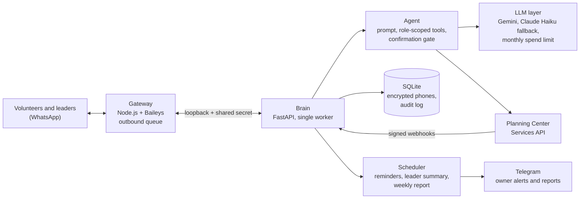

# Pleni

**A WhatsApp assistant that handles volunteer scheduling for a church, running in production.**

Pleni connects WhatsApp to [Planning Center Services](https://www.planningcenter.com/services), the system the church uses to schedule volunteers. People accept or decline a schedule, ask when they serve next, and get reminders, all in a WhatsApp chat. Leaders fill open positions and see who has not answered. An LLM with tool calling reads each message and decides what to do; the code decides what it is allowed to do.

This repository is a showcase. The source code is private because it handles real people's data ([details below](#why-the-source-is-private)).

  

## The problem

A church with two campuses in Rio de Janeiro schedules its volunteers (musicians, sound, reception, kids' ministry) in Planning Center. Planning Center sends its requests by email and through its own app, while the volunteers and their leaders talk on WhatsApp.

Pleni puts the schedule where the people already are: the request arrives as a message with two buttons, the answer goes back to Planning Center, and the leader is told right away when someone declines.

## What it does

**For volunteers**
- A notice when they are scheduled, with Accept and Decline buttons, and a reminder before the service. Musicians get the service's songs and keys in the reminder.
- Free-text questions and requests in Portuguese: "am I serving this month?", "I can't on the 29th", "accept all".
- A choice to stop bot messages at any time.

**For leaders**
- Scheduling by chat: search people, schedule one person, or schedule a whole team from a typed list or a photo of a handwritten list, with a preview and a confirmation before anything is written.
- An immediate notice when someone declines, with the reason.
- A daily summary of the coming services that need action: who is pending, who declined, which positions are open.

**For the owner**
- A weekly report on Telegram: usage, errors, AI cost, requests the bot could not fulfil, and improvement proposals drawn from the week's conversations.
- Immediate alerts when something breaks.

## Architecture

| Part | Stack | Role |
|---|---|---|
| Brain | Python, FastAPI, Pydantic, httpx | Webhooks, the agent, business rules, scheduled jobs |
| Gateway | Node.js, Baileys, Express | The WhatsApp connection and a send queue that paces messages |
| LLM layer | Gemini (`google-genai`), Claude (`anthropic`) | A provider-neutral turn loop with tool calling and fallback |
| Storage | SQLite, Fernet | Users, conversation history, notification state, audit log |
| Operations | pm2, git hooks, Cloudflare Tunnel, Docker | Process supervision, deploy on push, public webhook endpoint |

## Engineering decisions

The decisions that were hard to reverse are written down as ADRs, each with the options that were rejected and why. The full texts are in [`docs/adr/`](docs/adr).

| ADR | Decision | Why |
|---|---|---|
| [0001](docs/adr/0001-one-brain-on-server-two-numbers.md) | One brain on the server, two gateways, during a phone-number migration | Two brains would send duplicate reminders and lose track of who had migrated |
| [0002](docs/adr/0002-single-worker-process.md) | One worker process, by design | Rate limiters and per-user locks live in memory; Redis would be a new service for a load one event loop already serves |
| [0003](docs/adr/0003-gemini-primary-claude-haiku-fallback.md) | Gemini first, Claude Haiku as fallback inside the same turn | An outage hit every Gemini model at once; replies had a p90 of 73 s under the old retry policy |
| [0004](docs/adr/0004-whatsapp-complements-planning-center-notifications.md) | WhatsApp complements Planning Center's notifications, it does not replace them | The API has no per-person switch, and turning them off would cut off everyone who never wrote to the bot |
| [0005](docs/adr/0005-monthly-ai-limit-falls-back-to-the-free-key.md) | The app enforces its own monthly AI spend limit | The providers' consoles only send an email; a cap in code is the only one that stops the spending |

**The model proposes, the code decides.** This idea runs through the agent:

- **Role-scoped tools.** A volunteer's turn never sends the leader tools to the model. Volunteer tools take no person ID from the model: the backend injects the ID of the authenticated sender, so a prompt injection cannot act on someone else's schedule.
- **Writes need the person's own words.** Accepting or declining only happens when the current message asks for it, or answers "yes" to a question the bot asked about that schedule ([`snippets/03_schedule_answers.py`](snippets/03_schedule_answers.py)).
- **Phones are never stored in clear text.** Each one is encrypted, with an HMAC blind index for lookup ([`snippets/02_phone_blind_index.py`](snippets/02_phone_blind_index.py)).
- **Every webhook is authenticated**: HMAC-SHA256 for Planning Center, a shared secret, compared in constant time, on loopback for the gateway. Duplicate deliveries are dropped by an idempotency table, and a log filter masks tokens and phone numbers.

The project also keeps a [glossary](docs/GLOSSARY.md): one canonical word per concept, in the users' language, with the synonyms to avoid. Code, tests and commit messages use the same words.

## Code excerpts

Four short excerpts from the private codebase, with comments translated to English.

| File | Shows |
|---|---|
| [`01_llm_fallback.py`](snippets/01_llm_fallback.py) | Switching LLM provider in the middle of a turn without running a tool twice |
| [`02_phone_blind_index.py`](snippets/02_phone_blind_index.py) | Encryption at rest with an indexed lookup, and Brazil's ninth-digit variants |
| [`03_schedule_answers.py`](snippets/03_schedule_answers.py) | Authorizing a write from what the person said, in code |
| [`04_outbound_queue.js`](snippets/04_outbound_queue.js) | A send queue where a timed-out message is never sent late, which removed duplicate reminders |

## Quality and operations

- **1,015 automated tests** in pytest, plus Node tests for the gateway. Many tests start from a real incident: the conversation that went wrong becomes the scenario, and the fix has to make it pass.
- **Deploy on push.** A pre-push hook runs the whole suite and blocks a red push. The server pulls `main` every minute, restarts only the services whose code changed, and runs a health check on the new commit.
- **Built to fail safely.** When the primary LLM is down, the fallback takes over the same call. When the monthly AI limit is reached, the bot keeps answering on a free tier instead of going silent. When a message waits too long in the send queue, it is dropped and reported, never sent late.
- **Anti-ban discipline.** The bot only starts a conversation with people who have written to it and have not opted out, and it paces batch sends with typing time and jitter.
- **Observability for one person.** An audit log records each turn's provider, cost and latency; the owner gets alerts and a weekly report on Telegram.

## How it was built

I built Pleni with AI coding agents (mainly Claude Code), and most commits carry a `Co-Authored-By` trailer that says so. My part was the following:

- **The problem and the product.** I saw the problem in the church and decided what the bot should and should not do.
- **Specs and architecture.** I wrote the specs as GitHub issues and made the decisions recorded in the ADRs.
- **Direction and review.** Agents wrote most of the code under my direction; I reviewed it and kept the glossary, the coding standards and the test suite as the rules they work under.
- **Running it.** I operate it in production: I read the logs, investigate incidents with real users, and turn each one into a test.
- **Migrations.** I moved the system from a Mac to a self-managed Linux server and moved all users to a new WhatsApp number in waves.

## Numbers

| | |
|---|---|
| Timeline | 221 commits from 2026-10-17 to 2026-11-20 |
| Application code | about 24,800 lines of Python and 1,500 of JavaScript |
| Test code | about 21,900 lines, 1,015 tests |
| Users | used weekly by dozens of volunteers across two campuses |
| AI cost | capped at US$ 20 per month, enforced in code |

## Why the source is private

The repository's tests, plans and history refer to real church members and to the server it runs on, so it stays private. I am glad to walk through the code and the running system live, by screen share, in an interview.

---

**Romeo Gomes** · student

_Last updated: November 2026._
